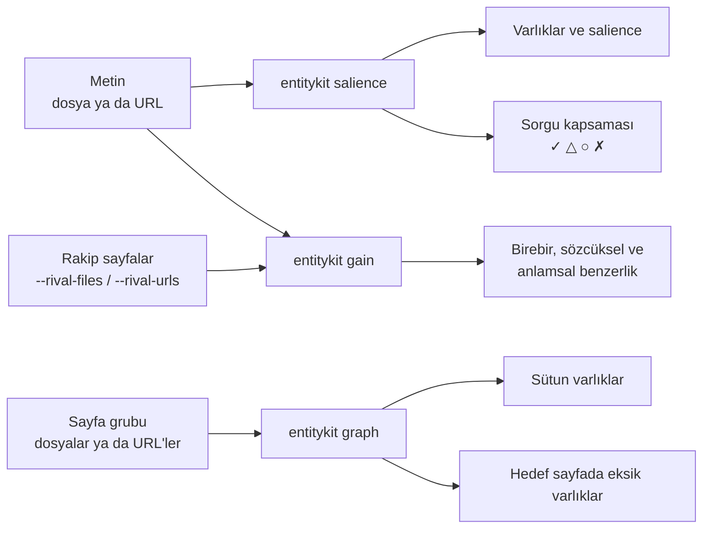
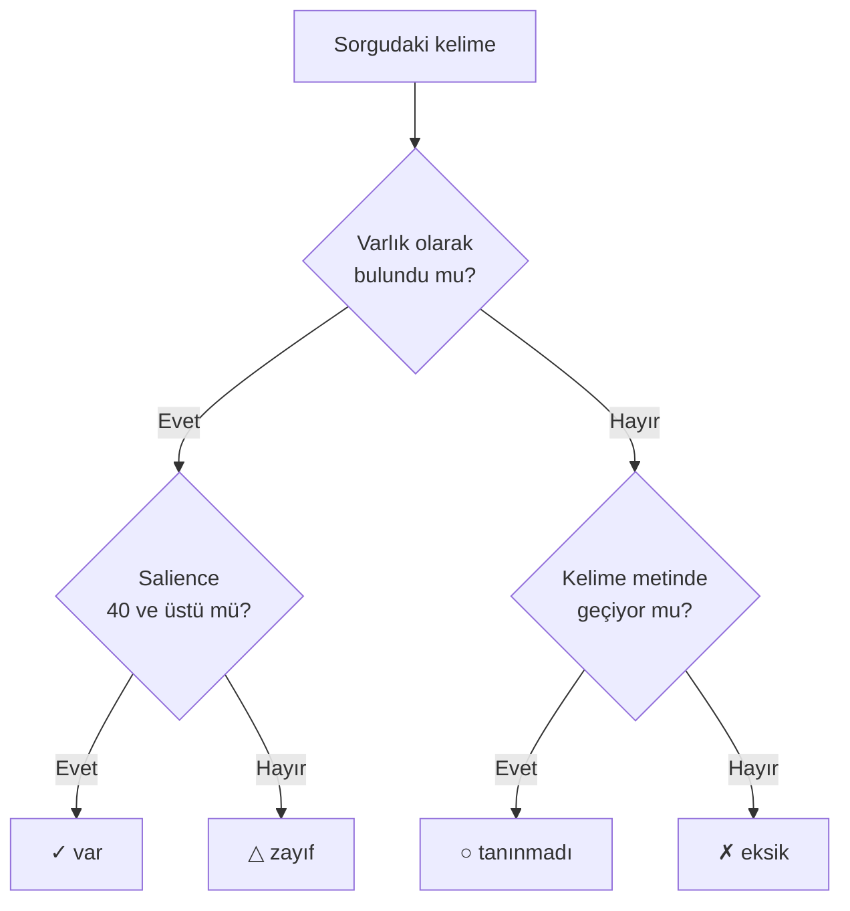

# entitykit


[](https://github.com/nazim/entitykit/actions/workflows/tests.yml)

Bu araç bir metindeki varlıkları bulur ve ölçer. Varlık, metnin üzerine kurulduğu
kişi, yer, kurum ya da kavram adıdır. Araç metni değiştirmez, yalnız rapor verir.

Üç soruya cevap verir:

- **Bu metin hangi varlıklar etrafında dönüyor?** Hangisi merkezde, hangisi kenarda?
- **Bu metin başka sayfalarda olmayan ne söylüyor?** Hangi cümle başka bir sayfadan
  kopya?
- **Bir sayfa grubu hangi varlıklar üzerine kurulu?** Bir sayfada eksik olan hangisi?

Araç Türkçe için ayarlıdır. Varsayılan varlık türleri Türkçedir. Çekim eklerini
köke indirir: "Otele", "otelde" ve "otelin" aynı varlık olur.

## İçindekiler

- [Kurulum](#kurulum)
- [Nasıl çalışır](#nasıl-çalışır)
- [İlk deneme](#ilk-deneme)
- [Komutlar](#komutlar)
- [Raporu okumak](#raporu-okumak)
- [Sınırlar](#sınırlar)
- [Terimler](#terimler)
- [Geliştirme ve testler](#geliştirme-ve-testler)
- [Sürümler ve lisans](#sürümler-ve-lisans)

## Kurulum

Gerekenler: Python 3.11, [uv](https://docs.astral.sh/uv/) ve modeller için yaklaşık
3 GB disk alanı.

```bash
uv tool install git+https://github.com/nazim/entitykit
```

Bu komut `entitykit`'i her klasörden çalışan bir komut olarak kurar. İlk
çalıştırmada modeller Hugging Face cache'ine, Türkçe kök bulma verisi de NLTK
klasörüne kendiliğinden iner.

Güncellemek için `uv tool upgrade entitykit`, kaldırmak için
`uv tool uninstall entitykit` çalıştır.

## Nasıl çalışır



| Komut | Ne yapar | Model |
|---|---|---|
| `entitykit salience` | Varlıkları bulur ve metindeki ağırlıklarına göre sıralar. Bir sorgudaki varlıkların metinde olup olmadığını gösterir. | GLiNER, bge-m3 |
| `entitykit gain` | Taslağın cümlelerini başka sayfalarla karşılaştırır. En özgün ve en tekrarlı cümleleri listeler. | bge-m3 |
| `entitykit graph` | Sayfa grubundaki varlıklardan bir ağ kurar. Merkezdeki varlıkları ve hedef sayfada eksik olanları gösterir. | GLiNER |

Türkçe kök bulma için zeyrek kullanılır.

GLiNER modeli `urchade/gliner_multiv2.1`, anlam modeli `BAAI/bge-m3`'tür. Wikidata
bağlantısı internet ister, API anahtarı istemez.


## İlk deneme

`examples/` klasöründe Kapadokya üzerine dört gezi sayfası var. `otel.md`'yi bilerek
iki kusurla yazdık:

1. Son cümlesi `urgup.md`'deki bir cümleyle aynı.
2. Diğer üç sayfada geçen "Nevşehir", `otel.md`'de hiç geçmiyor.

Repoyu indir, klasörüne gir ve üç komutla iki kusuru bul:

```bash
git clone https://github.com/nazim/entitykit && cd entitykit

# otel.md'nin varlıkları
entitykit salience examples/otel.md

# otel.md, diğer sayfalara göre ne katıyor?
entitykit gain examples/otel.md --rival-files "examples/*.md"

# dört sayfanın varlık ağı; otel.md'de ne eksik?
entitykit graph "examples/*.md" --target examples/otel.md
```

`gain` ortak cümleyi `urgup.md`'nin kopyası olarak gösterir. `graph` ise
"Nevşehir"i `otel.md`'nin eksiği olarak bulur:

```text
 SÜTUN VARLIKLAR (PageRank'e göre; konu bunların etrafında kurulu)
  rank  df      pr  varlık
     1   4 0.1504  Göreme
     2   3 0.1292  Nevşehir
     3   3 0.1191  Kapadokya
     4   3 0.0992  Uçhisar
     5   2 0.0821  Ürgüp
 ...
 KAPSAMA BOŞLUĞU — 'otel.md' sayfasında eksik sütun varlıklar
   ✗ Nevşehir                           df=3 pr=0.1292
```

Örneklerin tüm sonuçları [`references/findings.md`](references/findings.md)
dosyasında.

## Komutlar

Komuttan sonraki ilk argüman girdidir: bir dosya yolu ya da `http(s)://` ile başlayan
bir adres. Diğer seçenekler komutun ardından gelir. `entitykit <komut> --help` o
komutun bütün seçeneklerini listeler.

### entitykit salience

| Seçenek | Ne yapar |
|---|---|
| `--query "<sorgu>"` | Sorgudaki varlıkların metinde olup olmadığını gösterir. |
| `--preset <ad>` | Hazır varlık türü seti seçer: `genel`, `konaklama`, `urun`, `haber`, `teknoloji`. |
| `--labels "a,b"` | Kendi varlık türlerini verir. `--preset`'in yerine geçer. |
| `--second-pass` | Metinde geçen ama varlık sayılmayan kelimelerle ikinci kez ölçer. |
| `--enrich` | Aynı kavramın farklı yazımlarını birleştirir ("otel", "mağara otel"). |
| `--link` | Her varlığı Wikidata'daki karşılığına bağlar. |
| `--threshold <0-1>` | Varlık bulma eşiği. Varsayılan 0,45. |
| `--no-lemma` | Kök bulmayı kapatır. |

### entitykit gain

| Seçenek | Ne yapar |
|---|---|
| `--rival-files "<glob>"` | Rakip dosyalar. Birden çok glob'u virgülle ya da boşlukla ayır. |
| `--rival-urls "<a,b>"` | Rakip URL'ler. Satır başına bir URL içeren bir dosya da verebilirsin. |
| `--top <n>` | Listelerde kaç cümle gösterileceği. Varsayılan 10. |

Taslağın kendisi rakip listesinde varsa araç onu çıkarır.

### entitykit graph

| Seçenek | Ne yapar |
|---|---|
| Girdi | Sayfa grubu: glob, birden çok dosya ya da virgüllü URL listesi. |
| `--urls <dosya>` | Satır başına bir URL içeren dosya. |
| `--target <dosya ya da URL>` | Eksikleri aranacak sayfa. |
| `--preset`, `--labels`, `--threshold` | `salience` ile aynı. |

## Raporu okumak

Skorlar görelidir. İki sürümü ya da iki sayfayı karşılaştırmak için kullan. Skoru
geçti ya da kaldı notu gibi okuma.

`--query` raporu sorgudaki her kelimeye bir durum verir:



| Durum | Anlamı | Ne yapmalı |
|---|---|---|
| ✓ var | Varlık bulundu, salience yeterli. | Bir şey yapma. |
| △ zayıf | Varlık bulundu, ama metinde kenarda. | Konuya gerçekten aitse metinde öne çıkar. |
| ○ tanınmadı | Kelime metinde geçiyor, ama varlık sayılmadı. | Metne ekleme yapma. `--preset` ya da `--labels` ile tür setini genişlet. |
| ✗ eksik | Kelime metinde hiç yok. | Konuya aitse metne ekle. |

40 sınırı ve diğer ağırlıklar ölçülmüş değerler değil, varsayımdır.

`gain` benzerliği üç düzeyde ayırır:

| Düzey | Kanıt | Kopya mı? |
|---|---|---|
| Birebir eşleşme | 4 kelimelik dizilerin en az %95'i ortak. | Evet |
| Yüksek sözcüksel benzerlik | 4 kelimelik dizilerin en az %50'si ortak. | Büyük olasılıkla |
| Anlamsal yakınlık | Aynı şeyi farklı kelimelerle söylüyor. | Hayır |

Raporun ilk satırı (KAPSAM) kaç kaynağın okunduğunu ve neyin atlandığını yazar. Bu
satıra bak: eksik bir analiz tam analiz gibi görünmesin.

## Sınırlar

- Varlık bulma, aradığın türlere bağlıdır. Varsayılan türler "otel" gibi genel
  kavramları kaçırabilir. Bu durumda `--preset` ya da `--labels` kullan.
- `--url` menüyü, üst ve alt bilgiyi atar. `<main>` ya da `<article>` varsa yalnız
  onu okur. `<div class="sidebar">` gibi blokları temizlemez.
- Çok sayıda `--link` sorgusundan sonra Wikidata bir süre cevap vermeyebilir.
  Bağlantılar o zaman boş görünür. Biraz bekle ve yeniden çalıştır.
- Ölçümler vekil ölçümdür. Salience, Google'ın salience değeri değildir.
  PageRank, gerçek konu otoritesini göstermez.

## Terimler

| Terim | Anlamı |
|---|---|
| Varlık | Kişi, yer, kurum ya da kavram adı. |
| Salience | Bir varlığın metindeki ağırlığı. 0 ile 100 arası, aynı metnin en güçlü varlığına göredir. |
| Novelty | Bir cümlenin rakip sayfalardan ne kadar farklı olduğu. 0 ise aynısı vardır. |
| Sütun varlık | Sayfa grubunda en çok bağlantısı olan varlık. |
| df | Bir varlığın geçtiği sayfa sayısı. |
| QID | Wikidata'daki kimlik numarası, örneğin `Q27686`. |

## Geliştirme ve testler

Kodu değiştireceksen repoyu düzenlenebilir biçimde kur ve testleri çalıştır:

```bash
git clone https://github.com/nazim/entitykit && cd entitykit
uv venv --python 3.11
uv pip install -e .
.venv/bin/python -m unittest discover -s tests
```

37 test var. Testler model indirmez. numpy ya da zeyrek kurulu değilse unittest
ilgili testleri atlar. GitHub Actions aynı testleri her push'ta çalıştırır.

## Sürümler ve lisans

Değişiklikler [`CHANGELOG.md`](CHANGELOG.md) dosyasında.

MIT lisansı. Telif hakkı [nazim](https://github.com/nazim).
